# AMR Vision-Language Perception Pipeline

A real-time perception stack for an Autonomous Mobile Robot (AMR) that combines classical computer vision with vision-language models to navigate crowds safely.

The robot looks at a camera frame, detects people + walls, builds a cost map across 5 forward zones, and picks a heading.

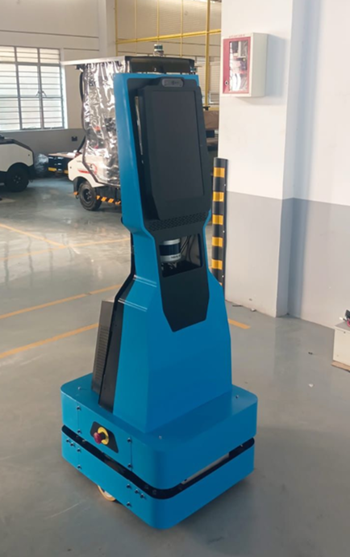

---

## How It Works

Four models run in sequence on every frame:

```
Camera frame
    │
    ├─► YOLOv8n ──────────────── detects people → zone + depth rank
    │
    ├─► Depth-Anything-V2-Small ─ monocular depth map → near/mid/far per person
    │
    ├─► SegFormer (ADE20K) ────── semantic segmentation → floor vs. wall per zone
    │                              (bottom 40% of each zone column)
    │
    └─► InternVL2.5-4B ────────── VLM reads image + sensor context
                                   → rates each zone: open / narrow / blocked
                                   (never picks the heading — only classifies space)

    All signals → deterministic costmap (5 zones × 5 depth rows, 0–100)
               → lowest-cost zone wins → bearing angle output
```

**Key design decision:** InternVL classifies background space (walls, doorways, narrow gaps). It never picks the heading. The heading is always computed deterministically from the costmap: people cost + wall cost + space classification.

---

## Tech Stack

| Component | Model / Library |
|---|---|
| Person detection | YOLOv8n (ultralytics) |
| Monocular depth | Depth-Anything-V2-Small-hf (transformers) |
| Semantic segmentation | SegFormer-b0-finetuned-ADE-512-512 (transformers) |
| Vision-language model | InternVL2.5-4B (transformers + timm) |
| Server | Python `http.server`, single-file, no framework |
| UI | Vanilla JS + HTML Canvas |

Runs on CPU or Apple MPS — no CUDA required.

---

## Setup & Running Locally

**Requirements:** Python 3.10+, ~8 GB RAM (models load on first request)

```bash
# 1. Clone and enter the project
git clone https://github.com/wang-julia/vlm-amr-26.git
cd vlm-amr-26/internvl_people_review

# 2. Create a virtual environment
python -m venv venv
source venv/bin/activate      # Windows: venv\Scripts\activate

# 3. Install dependencies
pip install -r requirements.txt

# 4. Start the server
python server.py
# Opens http://localhost:8021 automatically
```

Upload any image in the browser. The pipeline runs YOLO → Depth → SegFormer → InternVL and returns a heading decision with full costmap visualization.

**Batch evaluation (optional):**
```bash
python evaluate_folder.py evaluation_set/images/
python evaluate_folder.py --no-grounding   # A/B: skip sensor injection
```

---

## Demo Cases

### Case 1 — Outdoor crowd, multiple people at mid/far depth

8 people spread across center and center-right zones. YOLO catches all of them at varying depth ranks; depth map confirms the group is mid-range. The left zone is clear — robot steers **Left −72°**.

| YOLO + Depth | Heading |
|---|---|
| 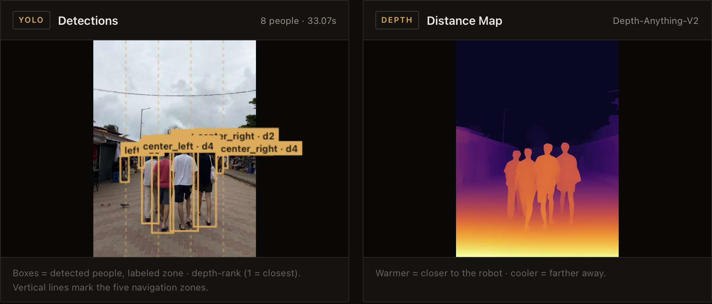 | 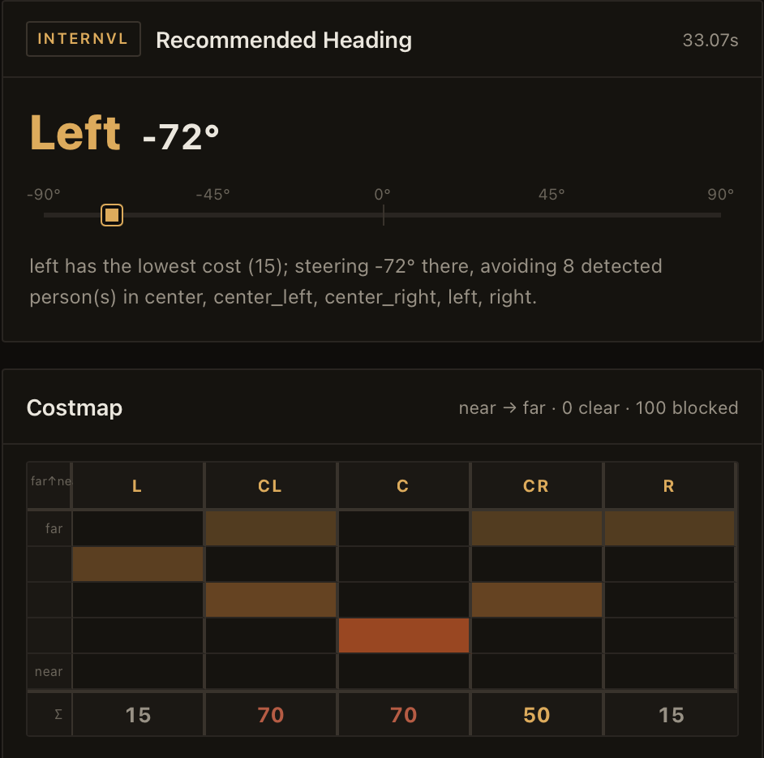 |

---

### Case 2 — Single person dead center, close range

One person at depth rank 1 (nearest) blocking the center zone. With only the center obstructed and equal cost on either side, the robot breaks the tie toward the most forward clear zone and steers **Left −36°** (center-left, cost 0).

| YOLO + Depth | Heading |
|---|---|
| 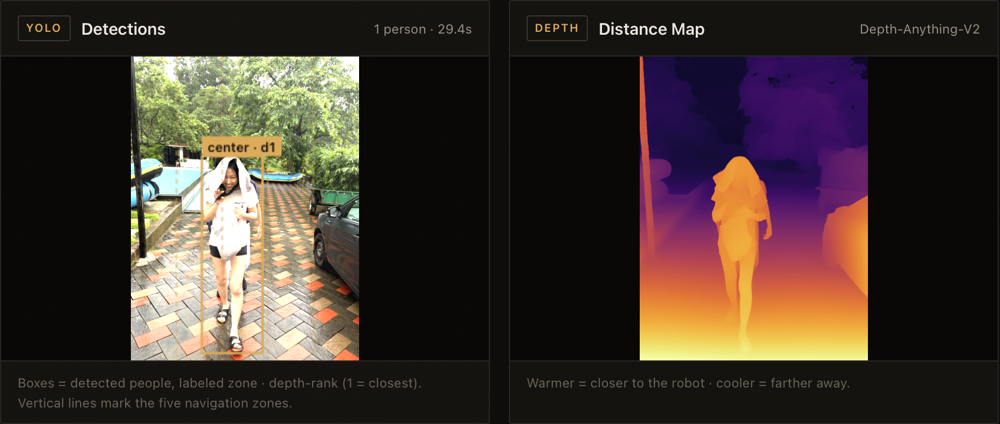 | 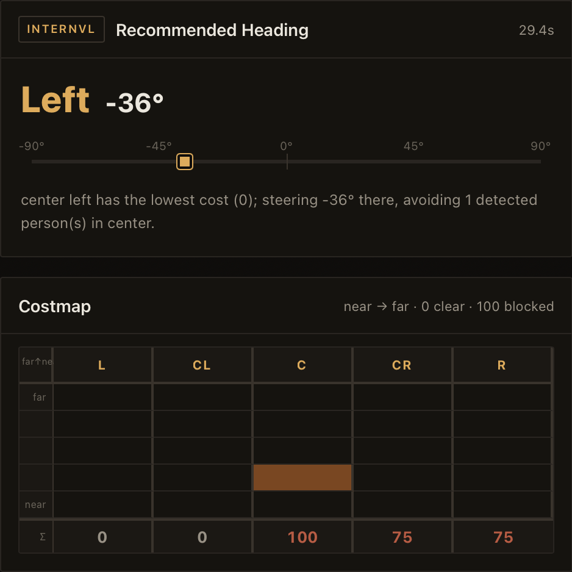 |

---

### Case 3 — Angled hallway, people at varied depths

3 people in a diagonal hallway — the leftmost person is closest (d1), others at d2/d3. The depth map correctly separates the near from the far despite the perspective angle. Left zone is open; robot steers **Left −72°**.

| YOLO + Depth | Heading |
|---|---|
| 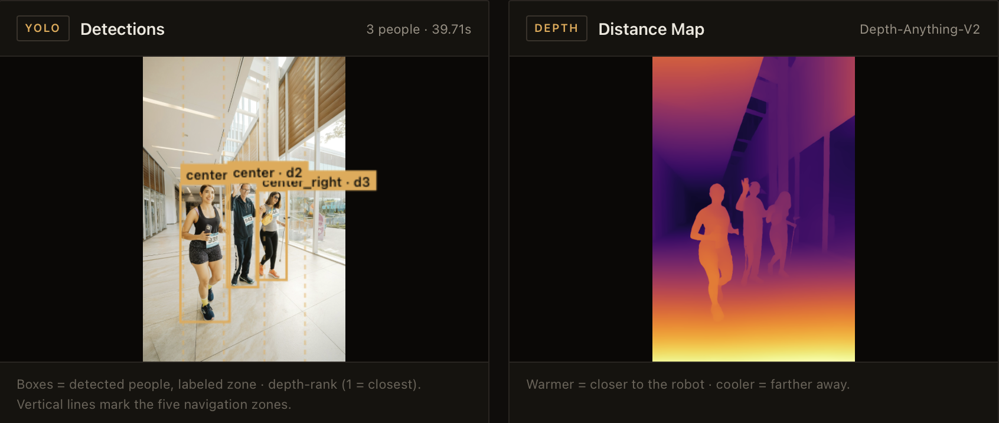 | 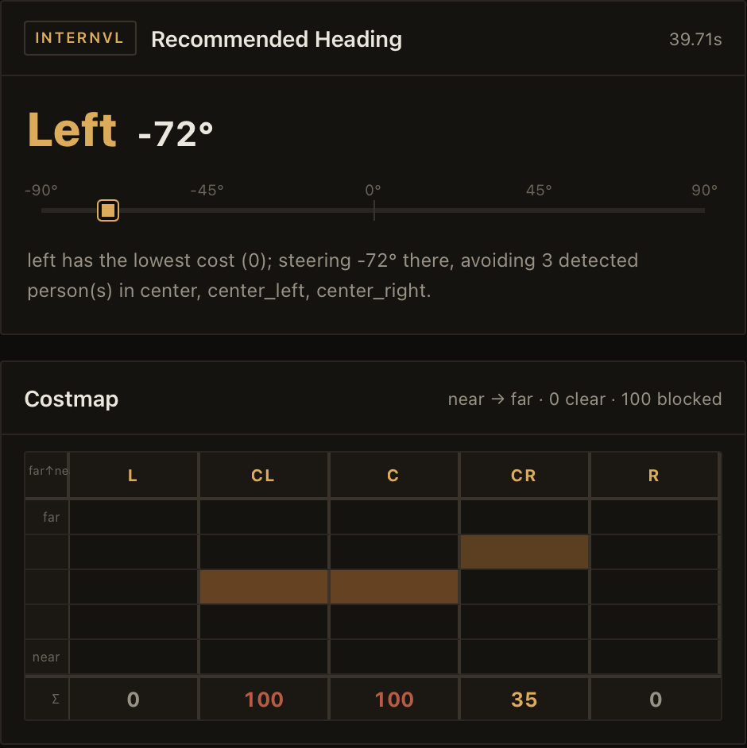 |

---

### Case 4 — Dense school hallway crowd, mixed sizes

10 people across left, center-left, center, and right — including adults seated at floor level and children of varying heights. YOLO handles the mixed scale; depth map differentiates the person at far-right (d1, nearest) from the group deeper in. Robot identifies left as lowest cost and steers **Left −72°**.

| YOLO + Depth | Heading |
|---|---|
| 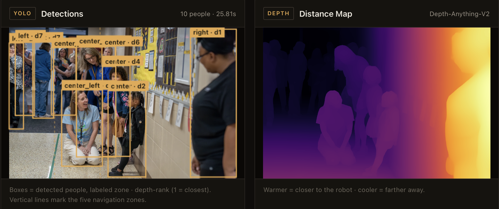 | 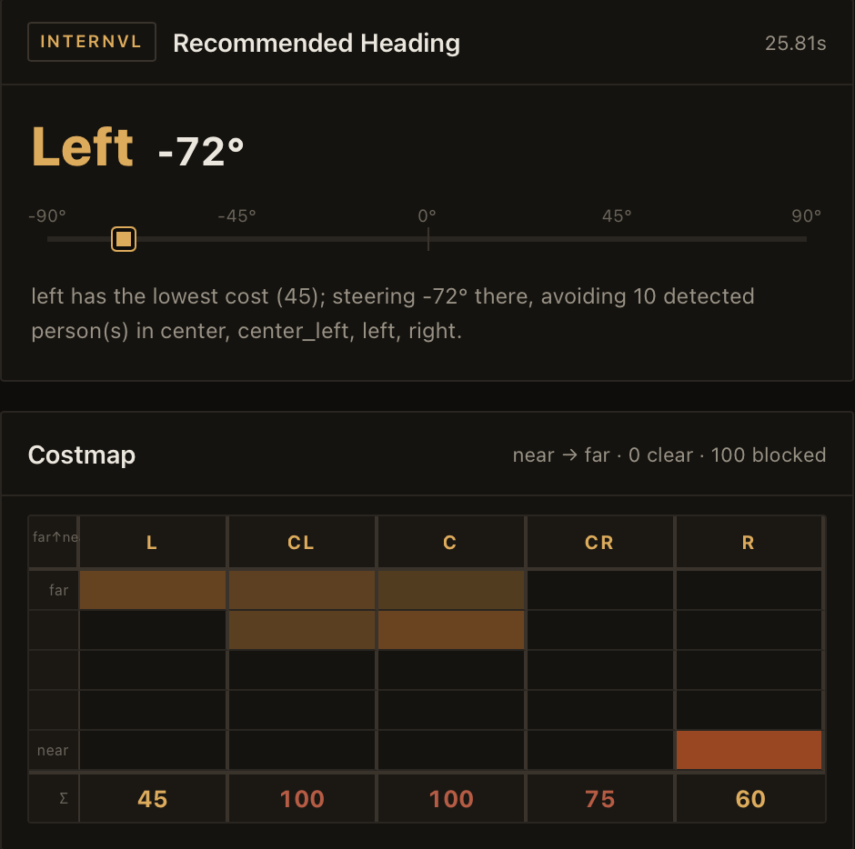 |

---

### Case 5 — Adults + child in a hallway, SegFormer active

A mother kneeling with a child — short stature means YOLO may undercount; SegFormer provides a floor-level cross-check. The corridor walls on both sides are classified as **blocked** by SegFormer (high `w%` wall coverage), which InternVL confirms. All five zones rated blocked; robot steers to center-left (lowest wall cost at 75) and avoids routing through detected walls.

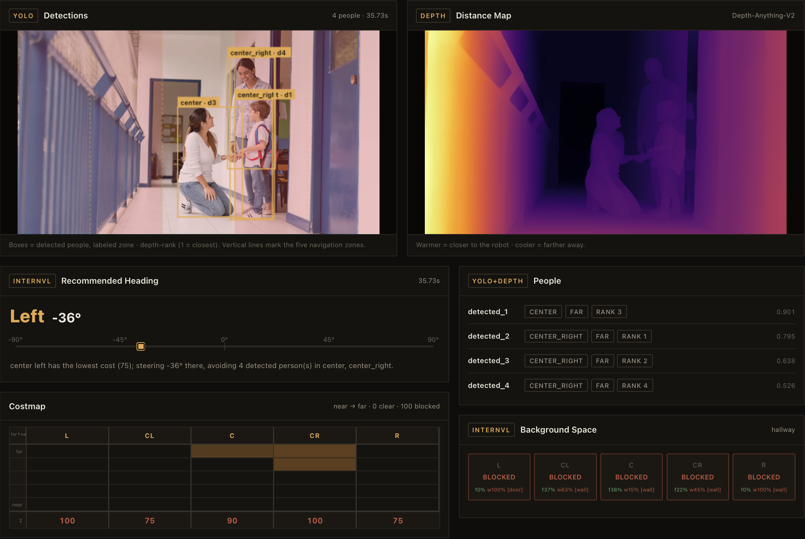

---

## Notable Features

- **Deterministic heading** — zone selection is pure arithmetic; the VLM cannot override it
- **2D costmap grid** — 5 zones × 5 depth rows (near→far), visualized as a heat table
- **Hard wall filter** — zones rated "blocked" are excluded from routing regardless of people cost
- **SegFormer grounding** — pixel-level floor/obstacle percentages shown per zone in the UI and fed to InternVL as calibration context
- **Zone tint overlay** — semi-transparent green/red tints on the camera canvas reflect SegFormer's floor vs. obstacle readings
- **Run history** — every inference is saved with full context, costmap, and detections for review
- **Sign-correct bearings** — left zones always negative degrees, right always positive; slider matches

---

## File Structure

```
internvl_people_review/
├── server.py              # HTTP server — /api/infer endpoint, serves the UI
├── detection_runtime.py   # YOLO + Depth-Anything + SegFormer; costmap builder
├── navigation.py          # Deterministic costmap fusion + heading selection
├── internvl_runtime.py    # InternVL inference + JSON repair
├── observations.py        # Schema validation for InternVL output
├── evaluate_folder.py     # Batch runner over an image folder
├── history_store.py       # Saves/loads run history as JSON + images
├── prompt.txt             # InternVL system prompt (space classification only)
├── requirements.txt
├── yolov8n.pt             # Auto-downloaded on first run
├── web/
│   └── index.html         # Single-page UI — canvas overlay, costmap grid, history
└── evaluation_set/
    └── images/            # 25 test images (corridors, crowds, open rooms)

vla-crowdsim/              # 2D crowd simulation — AMR navigates via social costmap
                           # using the Helbing Social Force Model + 36-ray lidar

social_nav_demo/           # Offline demo generator — fuses camera frames into
                           # an animated navigation preview (no live server needed)
```

---

## Simulation

**VLA CrowdSim** (`vla-crowdsim/`) is a live 2D simulation of the AMR navigating a classroom with 15 pedestrians using the Helbing Social Force Model. The robot's heading controller is driven by the same zone costmap signal produced by this pipeline — colored heatmap shows real-time social cost.

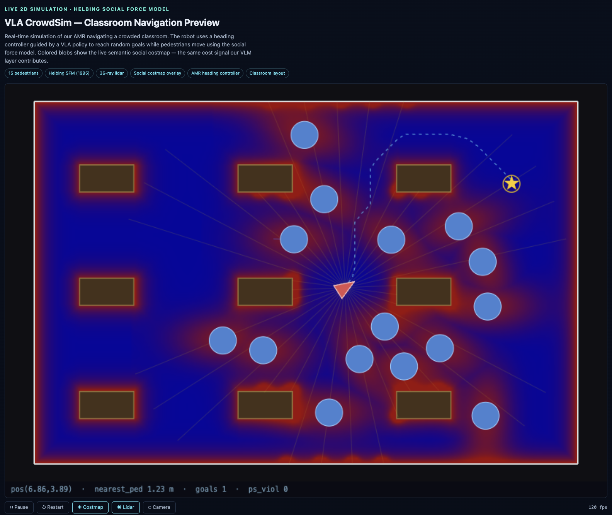 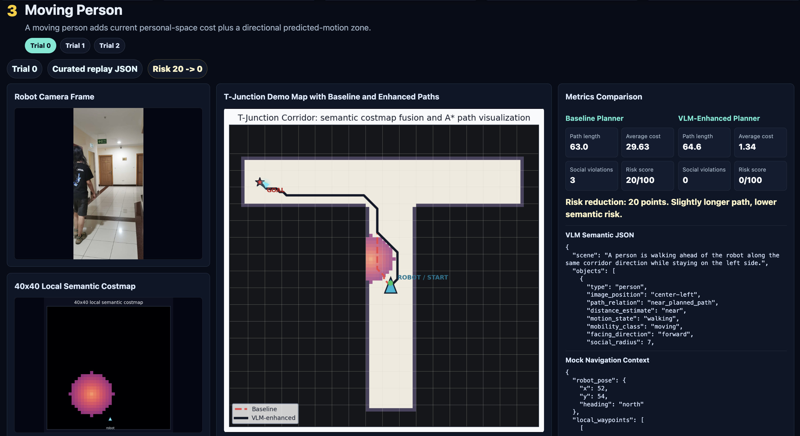
